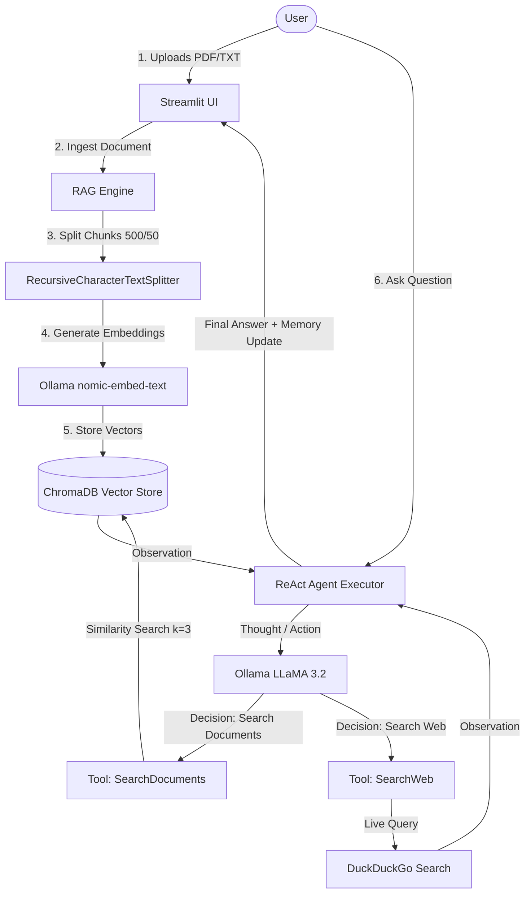

# SmartResearch — AI Research Assistant

> A local AI research assistant that combines Retrieval-Augmented Generation (RAG) with a ReAct agentic architecture. Upload documents (PDF / TXT), ask questions with persistent context, and automatically fall back to live DuckDuckGo web search when documents lack the answer.

---

## 📌 Features

- **100% Local Inference & Zero API Cost**: Runs locally via [Ollama](https://ollama.com/) using `llama3.2` and `nomic-embed-text`. No API keys required, complete data privacy.
- **RAG Pipeline**: Ingests PDF and TXT documents, chunks text with overlap, generates 768-dimensional embeddings, and stores them in ChromaDB.
- **Agentic Decision Making (ReAct)**: Uses LangChain's ReAct pattern (`Thought -> Action -> Observation`) to decide whether to query document embeddings (`SearchDocuments`) or fall back to web search (`SearchWeb`).
- **Live Web Search Fallback**: Automatically queries DuckDuckGo when documents don't have the answer.
- **Conversational Memory**: Retains the last 5 conversation exchanges using `ConversationBufferWindowMemory`.
- **Interactive UI**: Clean, responsive web UI built with Streamlit.

---

## 🏗️ Architecture & Data Flow



---

## 💡 Technology Decisions — The "Why" Behind Each Choice

| Component | Technology Chosen | Alternatives Considered | Why This Choice? |
| :--- | :--- | :--- | :--- |
| **LLM** | **Ollama + LLaMA 3.2 (3B)** | OpenAI API | Zero per-token cost, 100% privacy, no internet needed for core operations. |
| **Embeddings** | **nomic-embed-text** | `all-MiniLM-L6-v2` | Runs locally via Ollama, produces 768-dim embeddings specifically optimized for RAG tasks. |
| **Vector Store**| **ChromaDB** | FAISS, Pinecone | Requires zero setup, stores metadata natively, and persists to disk automatically. |
| **Orchestrator**| **LangChain** | Custom API scripts | Handles the ReAct agent loop, tool routing, memory, and document pipelines in ~20-30 lines. |
| **Web Search** | **DuckDuckGo Search** | Google Custom Search | Completely free, requires no API keys, and has generous rate limits. |
| **Frontend UI** | **Streamlit** | Flask / FastAPI + React | Rapid development; provides `st.chat_input` and `st.chat_message` out of the box in pure Python. |
| **Chunking** | **500 Chunk / 50 Overlap**| 1000+ token chunks | ~375 words provides sufficient paragraph context without diluting vector specificity; 50-token overlap preserves boundary context. |

---

## 📁 Project Structure

```text
QueryNest/
├── app.py              # Streamlit web UI & session state management
├── agent.py            # LangChain ReAct agent, tools, and conversational memory
├── rag_engine.py       # Document loaders, text splitters, embeddings, ChromaDB
├── requirements.txt    # Pinned dependency versions
├── .gitignore          # Excludes venv, vector database, and temporary files
└── README.md           # Project documentation and interview guide
```

---

## 🚀 Setup & Installation

### Step 1: Install Ollama
Download and install Ollama from [ollama.com](https://ollama.com). Verify installation:
```bash
ollama --version
```

### Step 2: Pull Required Models
```bash
ollama pull llama3.2
ollama pull nomic-embed-text
```

### Step 3: Set Up Python Virtual Environment
```bash
python -m venv venv
# On Windows:
venv\Scripts\activate
# On Linux/macOS:
source venv/bin/activate
```

### Step 4: Install Dependencies
```bash
pip install -r requirements.txt
```

### Step 5: Run the Application
```bash
streamlit run app.py
```
Open your browser at `http://localhost:8501`.

---

## 📖 How to Use

1. **Upload Documents**: Use the sidebar to upload a `.pdf` or `.txt` file and click **Process Document**.
2. **Ask Questions**: Type your question in the chat input.
3. **Automatic Fallback**: The agent first checks your uploaded documents. If the answer is not present, it searches DuckDuckGo for live web information.
4. **Contextual History**: The assistant remembers the last 5 interactions for follow-up questions.

---

## 🛠️ Troubleshooting

- **Ollama connection error**: Ensure Ollama is running (`ollama serve`).
- **Model not found**: Run `ollama pull llama3.2` and `ollama pull nomic-embed-text`.
- **Empty PDF extraction**: Scanned image PDFs require OCR. Ensure the PDF contains selectable text.
- **Parsing errors**: Handled automatically via `handle_parsing_errors=True` in `AgentExecutor`.
- **CPU latency**: LLaMA 3.2 3B generates ~5-15 tokens/second on CPU. For faster responses, `llama3.2:1b` can be used.

---

## 🎙️ Interview Cheat Sheet & Talking Points

- **Pitch**: *"I built a local AI research assistant that combines RAG with an agentic architecture. Users can upload documents for semantic Q&A, and the agent automatically falls back to DuckDuckGo search when document context is insufficient."*
- **RAG Pipeline**: *"Uploaded files are chunked into 500-token blocks with a 50-token overlap, embedded into 768-dimensional vectors using `nomic-embed-text` in Ollama, and indexed in ChromaDB for cosine similarity search."*
- **Agent Architecture**: *"A ReAct agent reasons via Thought-Action-Observation loops to dynamically route queries between `SearchDocuments` and `SearchWeb`, capped at 5 iterations to avoid infinite execution."*
- **Engineering Challenges**: *"Overcame CPU inference latency by selecting the lightweight 3B parameter model with low temperature (0.1) and resolved malformed LLM outputs using LangChain's parsing error handlers."*
